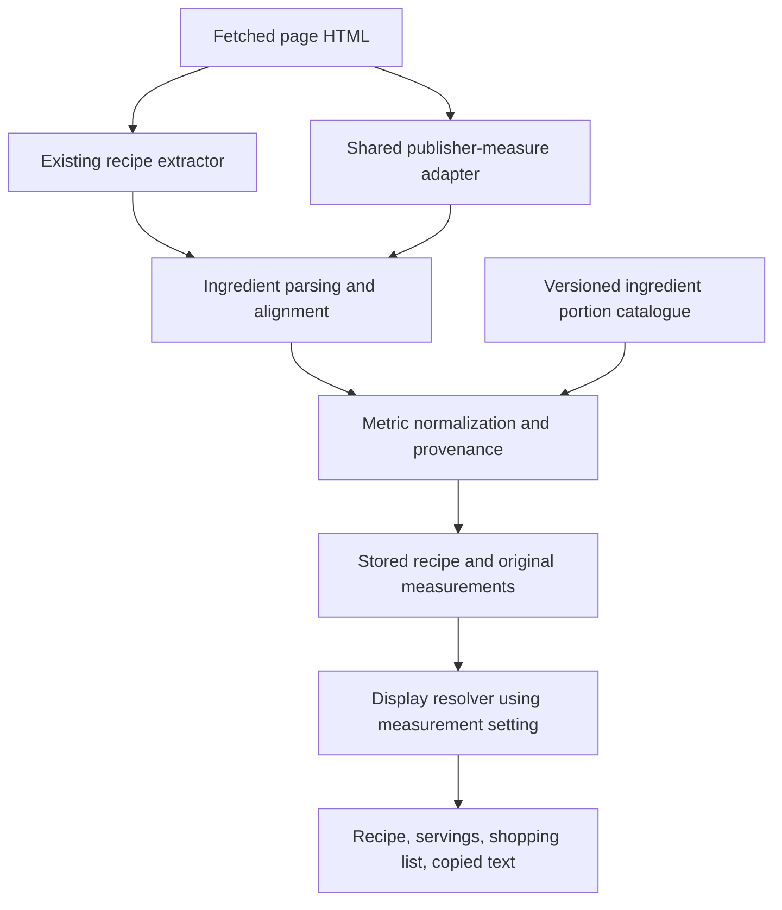

# Ingredient-aware cups and metric conversion

Research date: 2026-11-14. Status: historical research proposal. The user selected a simpler
implementation: a small editable list, US cups, no new dependencies, and unlisted ingredients
kept in cups. See [the implemented behavior](../features/measurement-preferences.md#common-ingredient-cup-conversions)
and [the translation experiment](../research/CUP_TRANSLATION_EVALUATION.md). The broader
catalogue, density profiles and additional library proposals below are not the chosen scope.

Related: [measurement preferences](../features/measurement-preferences.md),
[recipe import](../features/recipe-import.md),
[scraper integration](RECIPE_SCRAPERS_ADOPTION_PLAN.md).

## Recommendation

Prefer the publisher's alternative measurements, then use a versioned ingredient/portion
catalogue for conversions the publisher does not supply. Keep canonical metric quantities,
original source values, and conversion provenance separately. Apply the existing household
measurement preference when displaying recipes, scaling portions, generating shopping lists,
and copying lists.

There is no metric option to enable in our current recipe-scrapers integration. Add a shared
adapter for published measurement alternatives, initially supporting WP Recipe Maker's
embedded data across domains. Use a general conversion service for everything else. A
RecipeTin Eats provider is unnecessary.

The proposed first release uses deterministic .NET parsing/conversion and a small curated
USDA-backed catalogue. Python ingredient-parser-nlp is a useful later parsing experiment;
it does not remove the need for ingredient-specific portion data.

## Findings in Dishhive

| Area | Current behavior | Consequence |
| --- | --- | --- |
| `Resources/Localization/en.json` | Every `cup`/`cups` becomes 240 ml. | The ingredient and source cup convention are lost from the normalized unit. |
| `IngredientLineParser` | Accepts only leading decimal numbers followed by whitespace. | Fractions, mixed numbers, and attached units such as `50g` are not parsed correctly. |
| `UnitConversion` | Receives a unit token and quantity, without ingredient context. | It cannot distinguish flour, sugar, liquids, or packing/preparation. |
| `ImportedRecipe` / `ScrapedRecipe` | Ingredients are a list of strings. | There is no contract for a publisher's alternate metric measurements. |
| Python `/scrape` | Calls `scrape_html(...)`, then `ingredients()` with no arguments. | Only the default extracted ingredient lines are returned. |
| `MeasurementService` | Receives quantity and unit; converts mass to oz/lb and volume to fl oz/qt. | It cannot choose cups based on ingredient identity or source measurements. |
| `ShoppingListService` | Groups by lowercased ingredient name and canonical unit. | Display needs a way to retain compatible conversion context through aggregation. |
| Stored source data | Originals survive, but scraper `raw` is serialized library output. | Old imports usually do not retain the page's embedded alternate measurements. |

These are independent of interface language. English/Dutch localization must continue to
affect labels, without determining the measurement convention of the original recipe.

## Experiment: the supplied RecipeTin Eats recipe

Downloaded the [supplied page](https://www.recipetineats.com/lace-almond-tuiles-recipe/)
and ran the repository's pinned `recipe-scrapers==15.11.0` in an isolated research directory.
The library returns five default ingredient lines, including three unchanged fractional cup
quantities. Its `ingredients()` method takes no arguments. The public
[`scrape_html` signature](https://github.com/hhursev/recipe-scrapers/blob/15.11.0/recipe_scrapers/__init__.py)
has no preferred-unit-system parameter; the upstream main branch also lacks one.

The HTML includes `window.wprm_recipes`, with a recipe object keyed by `recipe-198082`.
Each ingredient has a stable `uid` and `unit_systems` alternatives. The observed pairings are:

| Ingredient | Default measurement | Published metric measurement |
| --- | --- | --- |
| Caster sugar | 2/3 cup | 130 g |
| Flour | 1/4 cup | 40 g |
| Butter | Combined weight/spoon text | 50 g |
| Juice | 3 tbsp | 45 ml |
| Flaked almonds | 3/4 cup | 60 g |

This is extraction of publisher-supplied values, not a density calculation. All five
ingredients have alternatives. No browser interaction or additional endpoint is necessary.
As a separate check, the [official WP Recipe Maker demonstration](https://demo.wprecipemaker.com/unit-conversion/)
has the same embedded structure and alternatives for all seven ingredients.

WP Recipe Maker's [own documentation](https://help.bootstrapped.ventures/article/18-unit-conversion)
explains that publishers configure two systems, can choose cup/spoon conventions, and can
edit calculated values. Therefore neither system number nor a generic density is a reliable
substitute for the published measurement. This also means these values are publisher-supplied,
not independently verified laboratory measurements.

Local evidence is under ignored `artifacts/research/cup-conversion/`:
`recipetineats-findings.json`, the downloaded HTML, `wprm-demo.html`, and `usda-example.json`.
The package installation is isolated there; application dependency files were not changed.

## Libraries and data sources

| Candidate | What it provides | Assessment for Dishhive |
| --- | --- | --- |
| [recipe-scrapers](https://github.com/hhursev/recipe-scrapers) | Existing HTML/schema extraction. | Retain. Our tested version has no metric switch. Enrich its result with shared publisher-data adapters. |
| [ingredient-parser-nlp](https://ingredient-parser.readthedocs.io/en/latest/how-to/convert-units.html) | Structured ingredient parsing and Pint-based conversion, including mass/volume when given a density. | Useful parsing candidate, not a complete density solution. Its documented default mass/volume density is water and must never be accepted implicitly for food. |
| [Ingredient Parser's FDC matching](https://ingredient-parser.readthedocs.io/en/latest/explanation/foundation.html) | Optional offline matching of ingredient names to USDA identifiers. | Worth benchmarking later. Identification does not itself establish a correct portion/preparation match. Its documentation reports a substantial parsing slowdown. |
| [Units.NET](https://github.com/angularsen/UnitsNet) | .NET quantities and conversions; separate [US customary, US legal, and metric cup definitions](https://github.com/angularsen/UnitsNet/blob/master/Common/UnitDefinitions/Volume.json). | Suitable optional unit-math dependency. It supplies unit definitions, not food portion weights. A small decimal-based converter also fits our limited unit set. |
| [USDA FoodData Central](https://fdc.nal.usda.gov/data-documentation/) | Ingredient records and household portion weights. | Recommended foundation for a curated local catalogue. Select explicit food/preparation records and ship a versioned snapshot. |
| [King Arthur Baking weight chart](https://www.kingarthurbaking.com/learn/ingredient-weight-chart) | Baking-specific ingredient/form measurements. | Valuable cross-check for tests and differences between ingredient forms. Do not treat all entries as one universal density. |
| [Spoonacular Convert Amounts](https://spoonacular.com/food-api/docs#convert-amounts) | Hosted ingredient-aware conversion API. | Possible optional provider. Authentication, quotas, network availability, and storage terms need evaluation before adoption. It should not be required to render a recipe. |

Ingredient Parser is [English-focused](https://ingredient-parser.readthedocs.io/en/latest/how-to/extending.html).
Adopting it would not replace Dishhive's Dutch parser. Benchmark it against the same English
and Dutch corpus before adding a second parsing path. Recommendation for the first release:
extend our deterministic numeric/unit parsing and use explicit bilingual ingredient aliases.
Do not add an AI task for measurement arithmetic.

USDA [documents portion fields](https://fdc.nal.usda.gov/portal-data/external/dataDictionary)
including `amount`, `modifier`, and `gram_weight`. A live public-demo API check found
FDC **169761**, all-purpose unenriched wheat flour, with a one-cup portion weighing **125 g**.
In this SR Legacy record, `measureUnit` is **undetermined** and `modifier` contains the cup
label. A loader that reads only `measure_unit_id` would miss it.

USDA [publishes the data under CC0](https://fdc.nal.usda.gov/api-guide/). Its API requires
a key and has request limits; downloadable snapshots avoid a runtime dependency.
Retain the FDC ID, release date, portion description, and source attribution with each entry.

The user's [calculator reference](https://www.thecalculatorsite.com/cooking/cups-grams.php)
is useful inspiration for ingredient selection and presentation. It distinguishes cup
conventions and measurement technique. It should not be our runtime service or a table
copied wholesale into the application.

The King Arthur chart gives **120 g** for a cup of all-purpose flour; the USDA example gives
**125 g**. Such differences reinforce the need to retain the reference and measuring method.
For this recipe, even the USDA quarter-cup estimate of 31.25 g would differ from its published
40 g measurement. Prefer the publisher's value for that recipe.

## Conversion rules

Use this priority per ingredient, with matching recipe servings and ingredient identity:

1. An explicit current user correction.
2. A valid publisher-supplied measurement in the requested system, including an unambiguous
   inline alternative such as a cup amount paired with a gram amount.
3. An exact conversion within the same dimension, using an established unit convention.
4. A reviewed ingredient/portion profile matching the ingredient form and preparation.
5. A graceful fallback that retains the source measurement or the existing weight display.

Mass/volume conversion requires a profile. With density `d` in g/ml and cup volume `V` in ml:

```text
grams = cups * V * d
cups = grams / (V * d)
cups = milliliters / V
```

Alternatively, a measured `gramsPerCup` profile can be used directly for its documented
cup convention. Do not invent a g/ml density from an undefined household cup. Every profile
needs a declared reference unit and a known basis before conversions across cup standards.

US customary cups are 236.5882365 ml; US legal cups are 240 ml; metric cups are 250 ml.
These distinct definitions are represented in Units.NET. Source convention must come from
explicit source metadata or a documented assumption, never from the interface language or
country inferred solely from a domain. An unresolvable convention remains marked unknown.
Use US customary cups as the documented target convention for the existing Imperial setting;
label the setting more clearly when this feature ships. A source's known metric-cup variant
can be retained, but must not silently be relabeled a US cup.

Profiles must distinguish, for example, whole/sliced/slivered almonds, granulated/packed brown/
powdered sugar, cooked/raw rice, sifted/unsifted flour, and chopped/whole ingredients. Match
the measured form, including whether preparation happens before or after measurement.
Ambiguous alternatives, heaped measures, unspecified packing, and unsupported mixtures must
not receive a guessed density. Never default unknown ingredients to water.

For metric display, prefer weight for supported solids and volume for liquids or genuinely
volume-based source measures. A recognized cup volume can still become ml without a density,
but do not present that as a weight conversion. If the cup convention itself is unknown,
retain the source cup measurement and expose that conversion is unavailable.

For Imperial display, use publisher cup measurements or a matched profile where appropriate;
volume-to-cups needs no food density. Keep oz/lb for ingredients without a reliable cup
equivalent, such as an unspecified cut of meat. Retain practical spoon/count measures.
Scale first, convert once, round last. Render useful fractions only within a defined error
tolerance; retain a decimal rather than rounding a small nonzero quantity down to zero.
Catalogue-derived mass/volume conversions are estimates and should carry a localized
approximation indicator. Publisher measurements need provenance, not a false claim of exactness.

## Proposed architecture and data contract



### Publisher alternatives

Add a shared enrichment step using the already fetched HTML. The initial WP Recipe Maker
adapter belongs in the Python sidecar, where BeautifulSoup is already available. Return a
new optional structured ingredient-measurements field alongside the existing string list,
so the .NET client remains compatible with an older sidecar during deployment.

Parse the JSON value assigned to `window.wprm_recipes`; do not execute page JavaScript.
Handle observed `unit_systems` data and a tested fallback for `converted` data. Scope to the
selected recipe container/ID, ignore ingredient-group headings, and align by stable ingredient
UID plus a validated relationship to extracted lines. Do not zip unrelated arrays by position
alone. Reject ambiguous multi-recipe matches, duplicate IDs, malformed or nonpositive values,
and partial alternatives that cannot be aligned. Missing alternatives fall back per ingredient.

Identify systems from their units and available metadata. System 2 is not universally metric;
publisher labels are configurable. A system can also legitimately retain spoons or pieces.
The generic adapter must have no RecipeTin hostname branch. The existing safe fetcher remains
the only page network boundary; metric extraction adds no browser, remote script execution,
or site-specific endpoint calls. Run enrichment consistently for preview and persisted import.

### Ingredient storage and catalogue

Keep existing `Quantity`/`Unit` as canonical metric values wherever normalization succeeds.
Preserve `OriginalText`, `OriginalQuantity`, and `OriginalUnit`. Add measurement metadata for:

- Published alternatives: source ingredient ID, quantity/unit, actual unit convention, base
  servings, and publisher provenance.
- Conversion resolution: ingredient profile ID, preparation/packing, reference measurement,
  applied factor, catalogue version, and whether the result is estimated or unresolved.
- Current-value revision: enough to detect when an edit invalidates a prior source pairing.

Persist the resolved factor/version rather than silently changing an existing recipe when
the catalogue is updated. User edits to quantity, unit, or ingredient identity invalidate stale
derived measures; they must not be overwritten by the next display calculation. Original
source fields remain available for comparison.

Start with an embedded JSON catalogue with English identifiers, reviewed English/Dutch aliases,
food form, portion weights, cup basis, provenance URL/FDC ID, and data version. Cover common
baking ingredients and liquids first. Match deterministically to specific profiles. Broad
semantic or substring matches such as matching almond flour to almonds are unsuitable.
Source-specific pairs remain local to their recipe and must not become global density rules.

### Display and shopping lists

Resolve ingredient context in .NET once and return the needed measurement metadata through
the generated API client. Extend Angular's shared formatter to accept that context, select
the requested system, scale, and localize the result. Supply this same context to recipe
quantities and shopping-list copy. Cache metadata with recipes for offline use.

When canonical normalization is unavailable, retain parsed source measures for display and
scaling instead of dropping the quantity. Unparseable ranges or ambiguous combined quantities
remain verbatim. A display-only conversion must never rewrite persisted quantities.

Shopping lists aggregate canonical amounts before display rounding. Preserve compatibility
information from contributing ingredients. A recipe-specific cup ratio cannot arbitrarily
represent a total combined from recipes with different ratios or packing. Use cups for a
combined row only when its contributing contexts are compatible; otherwise retain the weight
total or separate incompatible rows. Keep unresolved source units separate from metric totals.

Use English localization keys such as `measurementUnit.cup`, `measurement.approximate`, and
`measurement.conversionUnavailable` in both interface catalogues.

## Implementation sequence

| Phase | Work | Completion criteria |
| --- | --- | --- |
| 1. Parsing | Extend `IngredientLineParser`; separate numeric parsing from context-aware normalization; remove unconditional cup normalization. | ASCII/Unicode fractions, mixed numbers, decimal commas, attached units and inline alternatives work; ranges and package sizes remain safe. |
| 2. Publisher data | Add generic WPRM enrichment, optional sidecar response fields, `ScrapedRecipe` / `ImportedRecipe` support, persistence metadata and EF migration. | The supplied recipe uses all five published metric values; an unrelated WPRM fixture also works; missing/ambiguous data falls back. |
| 3. Conversion catalogue | Add a versioned USDA-backed snapshot and a .NET ingredient measurement service. | Reviewed profiles support cups to grams and the inverse; ml to cups uses an explicit convention; unknown matches never use a guessed density. |
| 4. Shared display | Extend DTOs, regenerate NSwag artifacts, integrate recipe/scaled quantities/shopping/copy, and add localized estimates. | Metric and Imperial settings work consistently in English and Dutch, including offline and live setting changes. |
| 5. Existing recipes | Add a previewable, selective recalculation path based on preserved originals and measurement metadata. | Unedited cup imports can be repaired without replacing recipes, losing IDs, or changing unrelated recipe content. |

Existing decimal cup imports may already store ml, and fractional cup lines may be entirely
unparsed. Recover candidates from their original fields; do not simply reinterpret every ml
ingredient as a former cup. Protect edited quantities. Old `SourceRawData` may lack publisher
alternatives, so recovering those requires a deliberate source refresh; a database migration
must not make network requests. Show a before/after preview for existing-recipe corrections.

Implementation touchpoints are `src/dishhive-scraper/app.py` and `test_app.py`;
`Services/Import/{RecipeScrapersClient,RecipeScrapersFallbackProvider,ImportedRecipe,
RecipeImportService,IngredientLineParser,UnitConversion}.cs`; recipe entities/DTOs/mapping;
`Services/ShoppingList/ShoppingListService.cs`; the Angular measurement service and consumers;
API generation, localization resources, and recipe backup round trips.

## Acceptance and verification

- Fixture-based source extraction: both observed WPRM sites; both system orders; more than one
  recipe on a page; group headings; absent/partial/malformed alternatives; duplicate ingredient
  IDs; incompatible alternate servings; script strings containing braces. No JavaScript runs.
- Numeric parsing: `2/3`, `1 1/2`, `1½`, `½`, `0,5`, `50g`; distinguish a fraction slash from
  a dual-unit separator; do not add alternate representations together or use container weight
  as the recipe's requested quantity. Invalid fractions/ranges retain usable originals.
- Data/conversion: preparation and packing differences, bilingual aliases, unknown ingredients,
  source metrics overriding a catalogue, matching cup conventions, and approximate round trips.
- Data integrity: no original mutation, no drift from repeated unit switches, no double
  conversion of already-metric values, edit invalidation, and preservation in backup/export.
- UI: source metrics when Metric is selected; supported cup equivalents when Imperial is
  selected; practical fractions and small values; live setting changes; original-value toggle;
  scaled servings; shopping totals/copy; offline recipes; English and Dutch at 360/1280 px.
- Run scraper fixture tests, applicable .NET tests, API-generation checks, Angular tests/build,
  localization validation, affected browser tests, and `git diff --check` during implementation.

This research pass verified real page payloads, the pinned scraper's behavior, and one live
USDA portion record. It did not benchmark ingredient-parser-nlp, evaluate a paid conversion
API, build a complete ingredient catalogue, or change application behavior.
